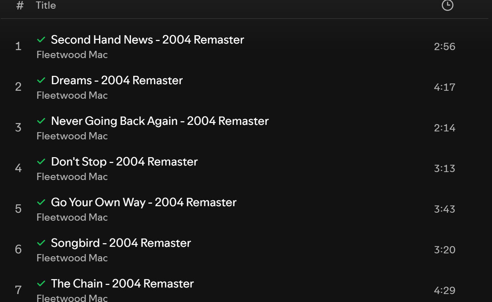
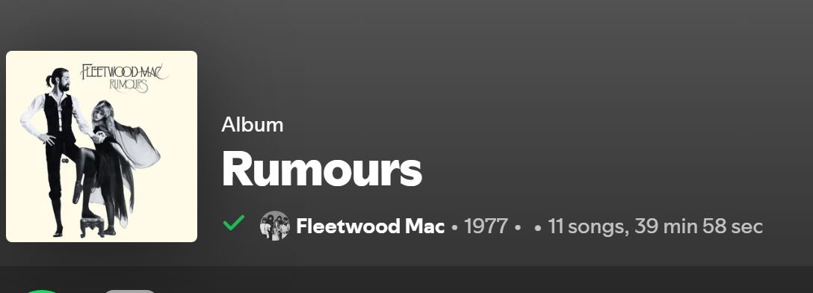
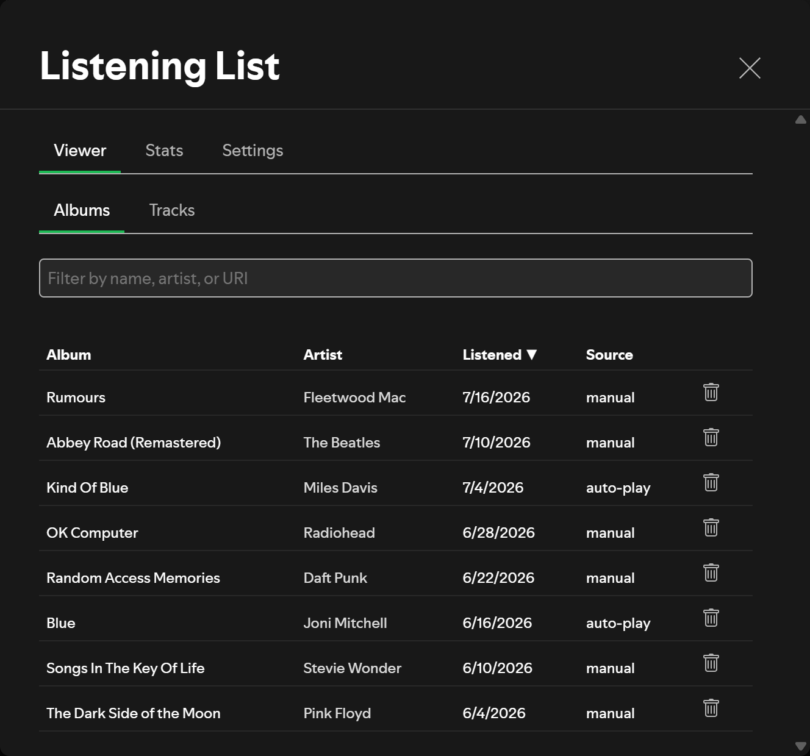
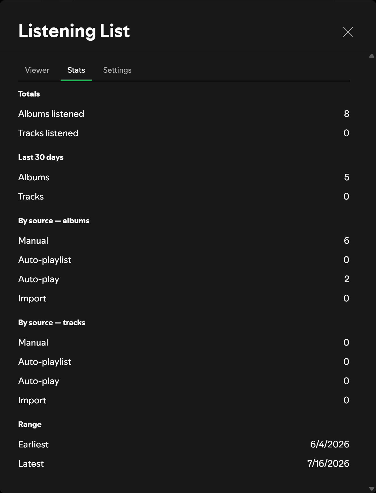
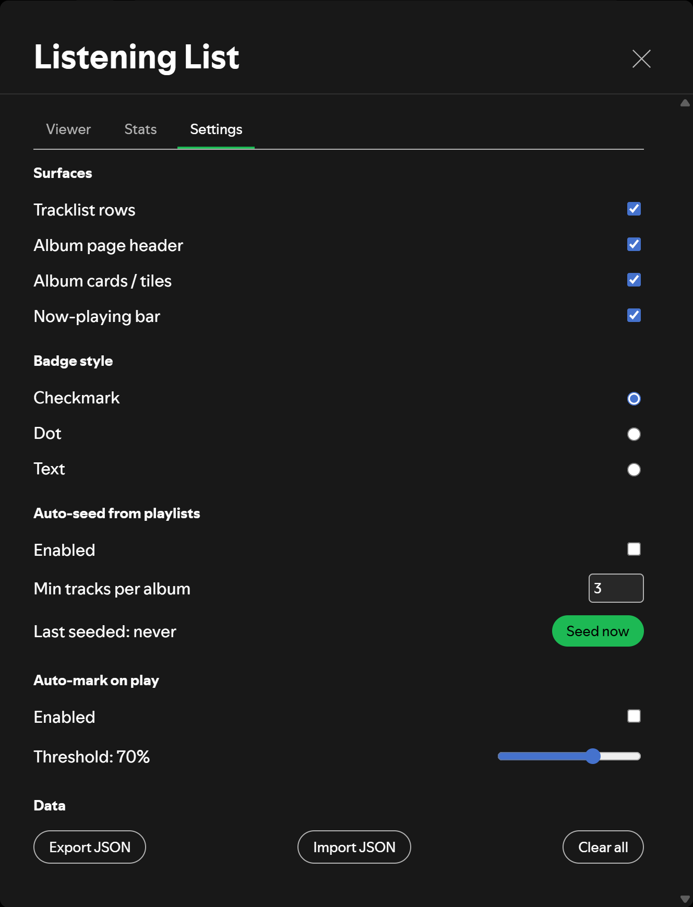

# Spicetify Listening List

<!-- site:skip-start -->
**Documentation:** https://spicetify.yusufaf.dev/listening-list/
<!-- site:skip-end -->

Mark albums and tracks as listened, with inline indicators across Spotify.



## Features
- Mark albums and tracks as listened via right-click context menu
- Want-to-listen list for albums: bookmark badge until you've heard it, then it flips to listened automatically
- Inline badge surfaces (tracklist rows, album page header, album cards, now-playing bar) — each toggleable
- Auto-seed listened albums from your playlists (threshold configurable)
- Auto-mark tracks past a play-progress threshold (threshold configurable)
- Local-only storage; nothing leaves your machine
- Export / import JSON
- Built-in viewer (sortable list) and stats summary

## How It Works
The extension stores two LocalStorage records: your listened items and your configuration. DOM observers attach small badges to tracklist rows, album headers, album cards, and the now-playing bar based on whichever surfaces you enable.

## Install

Requires [Spicetify](https://spicetify.app/docs/getting-started), installed and applied at least once.

### From Spicetify Marketplace

1. In Spotify, open [Marketplace](https://github.com/spicetify/marketplace) (the shopping-cart icon at the top left) and stay on the **Extensions** tab.
2. Type `Listening List` into **Search Extensions…**.
3. If no card shows up, click **Load more** below the results until it does. Marketplace only searches the extensions it has already loaded, 100 repositories at a time, so this one usually isn't there on the first try. Changing **Sort by** doesn't help, since it only reorders what's loaded.
4. Hover the **Listening List** card, click its download button, then click **Reload now**.

### Manually

1. Download [`listening-list.js`](https://raw.githubusercontent.com/yusufaf/spicetify-listening-list/main/listening-list.js) (right-click → **Save link as…**) into your Spicetify `Extensions` folder:
   - Windows: `%APPDATA%\spicetify\Extensions`
   - macOS / Linux: `~/.config/spicetify/Extensions`
2. Enable it and apply:

   ```bash
   spicetify config extensions listening-list.js
   spicetify apply
   ```

## Usage
Right-click any track or album → "Mark as listened". A badge appears in enabled surfaces. Right-click an album → "Want to listen" to queue it up; it shows a bookmark badge and moves to listened once you mark it or (with auto-mark on play enabled) play enough of its tracks. Open the profile menu → "Listening List" to access Settings, the Viewer (Albums / Tracks / Want to listen), and Stats.

## Screenshots

A marked album gets a badge on its page header:



The Viewer lists everything you have marked, with filtering and sorting:



Stats summarises totals, recent activity, and how each item got marked:



## Settings
Accessed via profile menu → "Listening List". Toggle surfaces, choose badge style, enable auto-seed / auto-on-play, export/import data, clear all.



## Troubleshooting
- Badges not appearing? Confirm the relevant surface toggle is on in Settings and reload Spotify.
- Auto-seed fails? The Spicetify Platform API for playlists is undocumented and varies by Spotify version. Check DevTools console for the error.
- Open DevTools: enable once via `spicetify enable-devtools`, then `Ctrl+Shift+I` inside Spotify.

## License
MIT — see [LICENSE](LICENSE).
